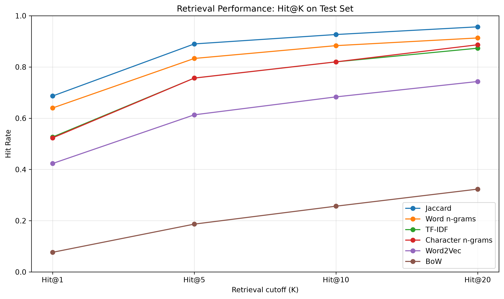
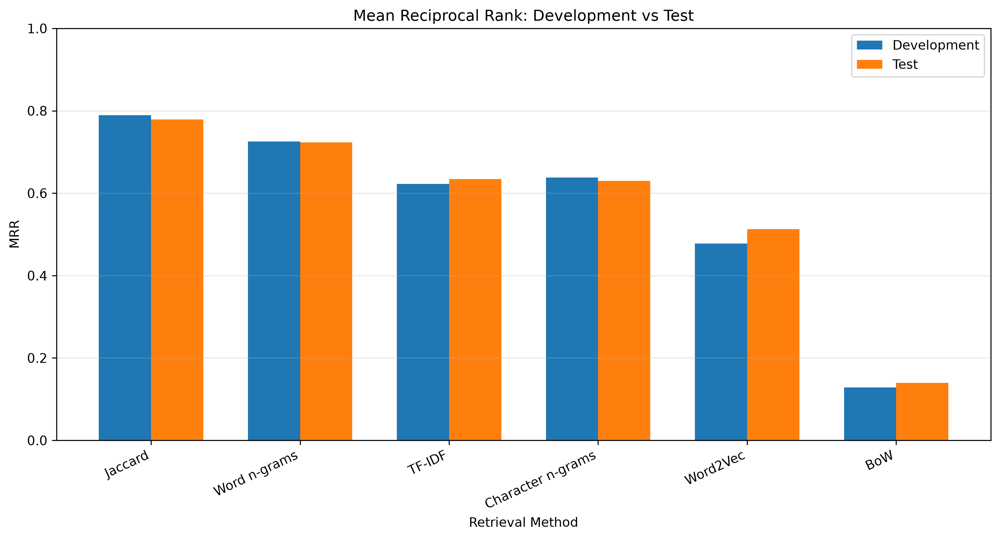
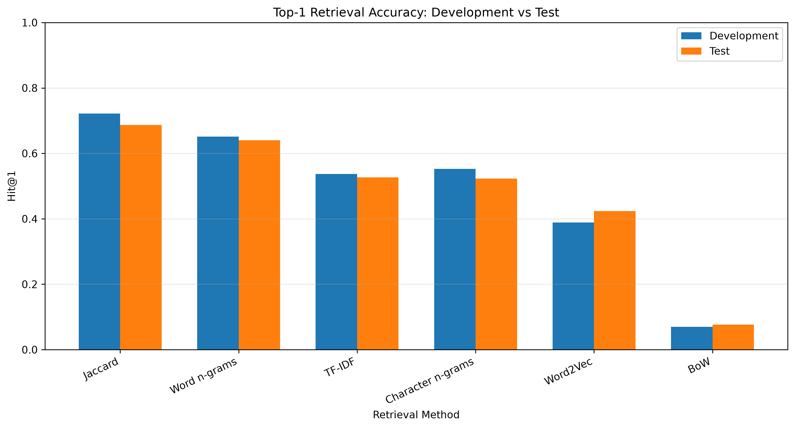

# Step 2 — Classical NLP and Text Representations

## 1. Introduction

This stage implements and evaluates classical NLP techniques for ingredient-aware recipe retrieval using the Food.com recipe dataset.

The objective is to retrieve recipes from a collection of existing recipes based on a query containing a subset of ingredients. Each recipe is treated as a document, and the query is compared with the ingredient representation of every recipe to produce a ranked list.

The experiments cover text preprocessing, several text representation techniques, similarity-based document retrieval, and quantitative evaluation.

The main research question is:

**How effectively can different classical NLP representations retrieve the original recipe when given only a subset of its ingredients?**

## 2. Dataset and Benchmark Construction

### 2.1 Recipe corpus

The experiments use the Food.com RAW_recipes dataset.

- Total recipes: 231,637
- Primary retrieval corpus: 231,637 recipes
- Recipe information includes names, ingredients, descriptions, preparation steps, and nutrition information.
- Ingredient lists are used as the primary content for ingredient-aware retrieval.

The RAW_recipes dataset was selected as the primary corpus because it provides broader recipe coverage than the corresponding PP_recipes subset.

### 2.2 Query generation

A synthetic ingredient-based retrieval benchmark was constructed from the recipe corpus.

Recipes containing at least five ingredients were eligible for query generation.

- Eligible recipes: 210,035 (approximately 90.67%).
- Total queries: 1,000.
- Development queries: 700.
- Final test queries: 300.

For each query, approximately half of the source recipe's ingredients were selected, while at least two ingredients were kept hidden. The recipe name was excluded from the query.

The source recipe ID was retained as the known relevant document for evaluation.

The development and test query source IDs were separated using a reproducible random split. The full recipe corpus, including source recipes, remained searchable in both evaluations.

This design evaluates whether a recipe can be retrieved from an incomplete ingredient list. It is a query-held-out evaluation, not a corpus-held-out evaluation.

## 3. Text Preprocessing

The same general preprocessing approach was applied to recipe text and ingredient-based queries.

### 3.1 Normalization

Text normalization includes:

- Conversion to lowercase.
- Replacement of hyphens with spaces.
- Removal of punctuation and non-alphanumeric special characters.
- Removal of repeated whitespace.

### 3.2 Tokenization

Text is tokenized by splitting normalized text into individual words.

### 3.3 Stopword removal

English stopwords were removed using the NLTK English stopword list.

Additional structural terms were removed:

- recipe
- ingredients
- preparation

Negation and other potentially meaningful terms were protected from removal, including words such as `not`, `no`, `without`, and `never`.

### 3.4 Lemmatization

POS-aware lemmatization was performed using NLTK.

Verbs were lemmatized as verbs, while other tokens were treated as nouns.

For example:

- `breasts` becomes `breast`.
- `tomatoes` becomes `tomato`.
- `chopped` can be reduced to its base verb form.

### 3.5 Spelling normalization

A small mapping was applied to selected spelling variants:

| Original | Normalized |
|---|---|
| chilli | chili |
| yoghurt | yogurt |
| sautee | saute |
| barbeque | barbecue |
| catsup | ketchup |
| aubergine | eggplant |
| courgette | zucchini |

Potentially distinct regional ingredient names, such as cilantro and coriander, were kept separate.

### 3.6 Preprocessing example

Input:

`Chicken breasts, chopped onions, and fresh tomatoes`

Normalized and processed output:

`chicken breast chop onion fresh tomato`

### 3.7 Preprocessing considerations

The preprocessing pipeline aims to reduce superficial text variation while preserving ingredient meaning.

Stopword removal and lemmatization reduce unnecessary vocabulary variation. Spelling normalization addresses selected regional or spelling differences.

However, preprocessing can also remove useful information if applied too aggressively. Negation-related terms were therefore protected.

## 4. Text Representation Techniques

Several classical representations were implemented to compare lexical and semantic approaches.

### 4.1 Bag of Words (BoW)

Bag of Words represents each recipe as a vector of term frequencies.

Each dimension corresponds to a vocabulary term, and its value represents the term's occurrence in the recipe.

Configuration:

- `CountVectorizer`
- `min_df = 2`

Advantages:
- Simple and interpretable.
- Captures the presence and frequency of ingredient terms.

Limitations:
- Does not understand semantic similarity.
- Does not preserve word order.
- Common terms can produce many tied similarity scores.

### 4.2 TF-IDF

TF-IDF assigns greater importance to terms that are informative within the corpus and lower importance to terms appearing frequently across documents.

Configuration:

- `TfidfVectorizer`
- `min_df = 2`

TF-IDF helps distinguish recipes using less common ingredient terms. However, it still relies on lexical overlap and does not directly understand synonyms or semantic relationships.

### 4.3 Word n-grams

Word n-grams extend lexical representation by considering sequences of one or more consecutive words.

Configuration:

- TF-IDF representation.
- `ngram_range = (1, 2)`
- `min_df = 2`

This representation captures individual terms and adjacent two-word combinations. It can help preserve useful ingredient expressions and local word patterns.

### 4.4 Character n-grams

Character n-grams represent text using sequences of characters rather than complete words.

Configuration:

- `analyzer = "char_wb"`
- `ngram_range = (2, 5)`
- `min_df = 2`
- `max_features = 100000`

This approach can capture partial word similarities and spelling variations. However, character overlap does not necessarily indicate that two ingredients have equivalent culinary meanings.

### 4.5 Word2Vec

Word2Vec learns dense word embeddings from the recipe corpus using contextual word co-occurrence.

Configuration:

- Vector size: 100
- Window size: 5
- Minimum word frequency: 2
- Skip-gram architecture (`sg = 1`)
- Training epochs: 10
- Random seed: 42

A recipe representation is obtained by averaging the embeddings of its recognized tokens.

Two approaches were compared:

- Unweighted mean pooling.
- TF-IDF-weighted mean pooling.

Full-text and ingredient-only representations were also evaluated.

The best-performing Word2Vec configuration in development was the ingredient-only, unweighted representation.

Although Word2Vec captures semantic relationships between food-related words, mean pooling can lose information about ingredient combinations and their relative importance.

## 5. Classical Retrieval Method

### 5.1 Document retrieval formulation

The retrieval task is formulated as a similarity-based document retrieval problem.

- Each recipe is a document.
- The input ingredient list is a query.
- The recipe corpus is the searchable collection.
- A similarity score is calculated between the query and each recipe.
- Recipes are ranked from highest to lowest similarity.

The system returns the highest-ranked recipes as retrieval candidates.

This is an information retrieval task rather than a supervised classification task.

### 5.2 Jaccard similarity

Jaccard similarity was implemented as a phrase-level ingredient overlap method.

Each recipe is represented as a set of normalized ingredient phrases. Query ingredients are processed in the same way.

The similarity between query set Q and recipe set R is:

\[
J(Q,R)=\frac{|Q\cap R|}{|Q\cup R|}
\]

The score ranges from 0 to 1.

- 1 indicates identical ingredient sets.
- 0 indicates no shared ingredient phrases.
- Intermediate values indicate partial overlap.

The use of ingredient phrases preserves expressions such as `black pepper`, `olive oil`, and `green onion` rather than treating every word independently.

### 5.3 Cosine similarity

Cosine similarity was used for vector-based retrieval methods, including BoW, TF-IDF, word n-grams, character n-grams, and Word2Vec.

It compares the direction of the query and recipe vectors rather than their absolute magnitudes.

The recipes with the highest cosine similarity scores are ranked first.

## 6. Evaluation Protocol

### 6.1 Development and test separation

The benchmark contains two disjoint query sets:

| Split | Number of queries |
|---|---:|
| Development | 700 |
| Final test | 300 |
| Total | 1,000 |

Development results were used to compare methods and select the preferred approach.

The final test set was evaluated after method selection and was not used for tuning.

The searchable recipe corpus remained the same for both splits.

### 6.2 Ranking and tie handling

Equal similarity scores can occur, particularly with set-based and term-frequency representations.

A stable tie-breaking rule was used for the final test evaluation. Recipes with equal scores are ordered according to their original corpus order.

The development Jaccard and BoW results were also recalculated using this rule because their initial evaluations showed substantial tie effects.

The other development methods had negligible tie rates, so their original development metrics were retained.

### 6.3 Evaluation metrics

The following ranking metrics were used:

**Hit Rate at K (Hit@K)**

Measures the proportion of queries for which the known source recipe appears within the first K retrieved results.

\[
Hit@K=\frac{\text{Queries with source recipe in top K}}{\text{Total queries}}
\]

Higher values are better.

**Mean Reciprocal Rank (MRR)**

Measures the average reciprocal rank of the known source recipe.

\[
MRR=\frac{1}{N}\sum_{i=1}^{N}\frac{1}{rank_i}
\]

Higher values indicate that the source recipe tends to appear closer to the top of the ranking.

**Mean Rank and Median Rank**

Measure the average and median position of the source recipe. Lower values are better.

### 6.4 Evaluation limitations

Each query has one known relevant document: its original source recipe.

However, other recipes in the corpus may also be relevant to the same ingredient query. These additional relevant recipes are not fully annotated.

Therefore, the reported metrics measure retrieval of the known source recipe rather than complete semantic relevance.

Precision, recall, and F1-score were not used as primary metrics because the benchmark does not contain complete relevance labels for all retrieved recipes.

## 7. Experimental Results

### 7.1 Development results

The following results were obtained on the 700 development queries.

| Method | Hit@1 | Hit@5 | Hit@10 | Hit@20 | MRR |
|---|---:|---:|---:|---:|---:|
| Jaccard | 0.7214 | 0.8671 | 0.9200 | 0.9471 | 0.7892 |
| Word n-grams | 0.6514 | 0.8100 | 0.8586 | 0.8929 | 0.7254 |
| TF-IDF | 0.5371 | 0.7200 | 0.7986 | 0.8371 | 0.6226 |
| Character n-grams | 0.5529 | 0.7329 | 0.8029 | 0.8514 | 0.6376 |
| Word2Vec | 0.3886 | 0.5757 | 0.6600 | 0.7100 | 0.4775 |
| BoW | 0.0700 | 0.1700 | 0.2514 | 0.3229 | 0.1285 |

### 7.2 Final test results

The final evaluation was performed on the 300 untouched test queries.

| Method | Hit@1 | Hit@5 | Hit@10 | Hit@20 | MRR |
|---|---:|---:|---:|---:|---:|
| Jaccard | 0.6867 | 0.8900 | 0.9267 | 0.9567 | 0.7787 |
| Word n-grams | 0.6400 | 0.8333 | 0.8833 | 0.9133 | 0.7236 |
| TF-IDF | 0.5267 | 0.7567 | 0.8200 | 0.8733 | 0.6339 |
| Character n-grams | 0.5233 | 0.7567 | 0.8200 | 0.8867 | 0.6301 |
| Word2Vec | 0.4233 | 0.6133 | 0.6833 | 0.7433 | 0.5127 |
| BoW | 0.0767 | 0.1867 | 0.2567 | 0.3233 | 0.1393 |

### 7.3 Visual comparison

#### Hit Rate at K

This figure compares the proportion of source recipes retrieved within different ranking cutoffs on the test set.

#### Mean Reciprocal Rank

This figure compares the ranking quality of each method across development and test queries.

#### Hit@1

This figure compares the proportion of queries for which the source recipe was ranked first.

## 8. Discussion

### 8.1 Jaccard similarity

Jaccard achieved the strongest overall performance.

On the test set, it achieved:

- Hit@1: 68.67%.
- Hit@5: 89.00%.
- Hit@10: 92.67%.
- Hit@20: 95.67%.
- MRR: 0.7787.

This result is consistent with the benchmark design. Queries are constructed from subsets of the source recipes' ingredients, so ingredient overlap is a highly relevant signal.

### 8.2 Word n-grams

Word n-grams were the strongest lexical alternative.

They achieved a test Hit@1 of 64.00% and an MRR of 0.7236.

Considering both individual terms and adjacent word combinations provides a useful representation for ingredient-based retrieval.

### 8.3 TF-IDF and character n-grams

TF-IDF and character n-grams achieved intermediate performance.

TF-IDF gives more importance to informative terms, while character n-grams capture partial spelling similarities. Neither method outperformed Jaccard or word n-grams in this benchmark.

### 8.4 Word2Vec

Word2Vec achieved a test Hit@1 of 42.33% and an MRR of 0.5127.

Its semantic representations are useful for capturing relationships between food-related words. However, averaging embeddings into one recipe vector can blur the distinctions between ingredient combinations.

In this experiment, exact ingredient overlap and lexical patterns were more effective than the tested mean-pooled embeddings.

### 8.5 Bag of Words

BoW achieved substantially weaker performance after correcting its ranking ties.

Its original term-frequency representation produced many recipes with identical scores. This demonstrated the importance of handling ties consistently when evaluating retrieval systems.

## 9. Selected Baseline

Jaccard similarity was selected as the preferred classical NLP retrieval baseline.

The reasons are:

1. It achieved the highest Hit@1 and MRR on both development and test queries.
2. It achieved a test Hit@10 of 92.67%.
3. It directly models ingredient overlap.
4. It is computationally and conceptually straightforward.
5. Its behavior is interpretable, since the similarity score is based on shared ingredient phrases.

Word n-grams remain a useful secondary baseline because they achieved competitive results.

The selected method is appropriate for the current ingredient-subset retrieval benchmark. Its performance should not be interpreted as proof that it is universally superior for all recipe search tasks.

## 10. Limitations and Future Improvements

Several limitations should be considered:

- **Synthetic queries:** Queries were generated from existing recipes rather than collected from real users.
- **Incomplete relevance labels:** Only the original source recipe is guaranteed to be relevant.
- **Corpus overlap:** Source recipes remain in the searchable corpus by design. This evaluates query-held-out retrieval, not generalization to unseen recipes.
- **Exact ingredient matching:** Jaccard does not inherently recognize synonyms or semantically equivalent ingredients.
- **Ingredient quantities:** The retrieval benchmark does not model ingredient quantities or proportions.
- **Word2Vec pooling:** Mean pooling can lose ingredient-level distinctions and combinations.
- **Language coverage:** The preprocessing pipeline was designed primarily for English text.
- **Tie-breaking:** Stable corpus-order tie-breaking provides deterministic ranks but can influence the order of recipes with identical scores.

Potential future improvements include synonym-aware ingredient normalization, ingredient ontology integration, improved semantic retrieval, and evaluation using manually annotated relevance judgments.

## 11. Conclusion

This stage implemented a complete classical NLP retrieval pipeline using the Food.com recipe corpus.

Text preprocessing, multiple text representations, similarity-based document retrieval, and ranking evaluation were implemented and compared.

Across 700 development queries and 300 final test queries, Jaccard similarity achieved the strongest performance, followed by word n-gram TF-IDF retrieval.

The experiments demonstrate that simple ingredient-overlap methods can be highly effective when queries consist of incomplete ingredient lists from existing recipes.

Jaccard is therefore selected as the classical retrieval baseline for the next stages of the NutriVision project.
